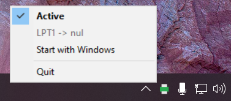

# NullPrn

[](https://github.com/ManiacPC/nullprn/releases/latest)

**Redirect a legacy parallel/USB printer port to the Windows null device — so old software that prints to `LPT1` stops failing on Windows 10/11.**

Many legacy (DOS-era / ERP / POS / lab) applications print by writing raw bytes to a port such as `LPT1`. On modern Windows the classic trick:

```bat
NET USE LPT1: \\server\NUL
```

often fails, because newer Windows releases added layers (redirector, session isolation, driver changes) on top of the old port mapping. NullPrn fixes this directly: it uses the Win32 `DefineDosDevice` API to point the port at `\Device\Null`, so **everything the program writes to the port "prints" successfully and is silently discarded** — no hangs, no error dialogs.

It lives quietly in the system tray, with a one-click on/off toggle.

<p align="center"> nul, Start with Windows, Quit"></p>

---

## Features

- ✅ Redirects `LPT1` (or any port) to the null device — writes succeed and are discarded.
- ✅ **Multiple ports** at once: `--port LPT1 --port USB001`.
- ✅ **Capture mode** — send what the program "prints" to a file instead of discarding it (`--target`), great for debugging what a legacy app is trying to output.
- ✅ **Start with Windows** — optional auto-start toggle (the redirection is per-login and does not survive a reboot on its own).
- ✅ Tiny tray app: green icon = active, grey = normal. One click toggles.
- ✅ No installer needed — grab the prebuilt `NullPrn.exe` from [Releases](../../releases) and run it.
- ✅ No admin rights required in the typical case.

## Download & run

**Just want to use it?** Download `NullPrn.exe` from the [Releases](../../releases) page and double-click it. An icon appears in the system tray.

- **Left-click / right-click the tray icon** for the menu.
- **Active** — toggle the redirection on/off.
- **Start with Windows** — keep it running after every reboot.
- **Quit** — removes the redirection and exits.

> **Verify your download.** Run `Get-FileHash .\NullPrn.exe` (PowerShell) and
> compare it with the SHA-256 for this release:
>
> ```
> 7896DC5DCB8A156FC1489BEB151669D491DBE43F2AFD96D1CEA6DAEE6516F84A
> ```

## Command-line options

Both the tray app and the exe accept:

| Option | Description | Default |
| --- | --- | --- |
| `--port PORT` | Port to redirect (e.g. `LPT1`, `USB001`). Repeatable for several ports. | `LPT1` |
| `--target PATH` | `nul` to discard, or a file path to capture printed data. | `nul` |

Examples:

```bat
REM Default: redirect LPT1 to nul
NullPrn.exe

REM Redirect several ports at once
NullPrn.exe --port LPT1 --port USB001

REM Capture whatever the legacy app prints into a file (debug)
NullPrn.exe --port LPT1 --target C:\temp\capture.prn
```

> **Capture note:** when a port is mapped to a file, each time the legacy program
> opens the port and writes, it writes from the start of that file. This is ideal
> for inspecting a single print job; it is not an append-forever log.

## Testing

`test_lpt1.py` prints a small ESC/P test page to a port the same way an old program would, so you can confirm the redirection works:

```bat
python test_lpt1.py                 REM tests LPT1
python test_lpt1.py --port USB001   REM another port
python test_lpt1.py --port LPT1 --port LPT2
```

It reports where the port currently points, how many bytes were written, and whether the write blocked (which is exactly the failure NullPrn prevents).

## Build from source

Requirements (Python 3.10+ recommended; built with 3.13):

```bat
py -3.13 -m venv .venv
.venv\Scripts\activate
pip install -r requirements.txt
```

Run directly without building:

```bat
pythonw nullprn_tray.py
```

Generate the executable icon from the tray design (produces `NullPrn.ico`):

```bat
python make_ico.py
```

Or do everything (icon + exe + SHA-256) in one step:

```bat
build.bat
```

Build the standalone exe manually with [Nuitka](https://nuitka.net/):

```bat
python -m nuitka nullprn_tray.py ^
  --onefile ^
  --windows-console-mode=disable ^
  --include-module=pystray._win32 ^
  --windows-icon-from-ico=NullPrn.ico ^
  --output-filename=NullPrn.exe
```

> If PyInstaller is your preference instead:
> `pyinstaller --onefile --noconsole --icon NullPrn.ico nullprn_tray.py`

## How it works

NullPrn calls `DefineDosDeviceW(DDD_RAW_TARGET_PATH, "LPT1", "\Device\Null")`, which
creates a DOS-device symlink for the current login session. When the legacy program
does `CreateFile("LPT1")` + `WriteFile(...)`, the writes go to the null device and
complete instantly. On exit (or toggle-off) NullPrn removes **only its own**
definition with `DDD_REMOVE_DEFINITION | DDD_EXACT_MATCH_ON_REMOVE`, leaving any
pre-existing mapping untouched.

Because the mapping is per-session, it is cleared on logout/reboot — use **Start with
Windows** to restore it automatically. That toggle creates a plain shortcut in your
Startup folder (`shell:startup\NullPrn.lnk`); it does **not** touch the registry, and
you can remove it by hand at any time.

## Antivirus note

NullPrn is a small, open-source Python app compiled with Nuitka. Unsigned
single-file executables that unpack themselves at startup can trigger
**behavioural (heuristic) false positives** such as Kaspersky's
`PDM:Trojan.Win32.Generic` — the binary is not malware, and the full source is in
this repo so you can audit or build it yourself.

If your antivirus flags it, you can:

- Build it yourself from source (see below) and run that binary.
- Verify the released `NullPrn.exe` against the SHA-256 in the release notes.
- Add an exclusion for `NullPrn.exe`, or report it to your vendor as a false positive.

## Changelog

See [CHANGELOG.md](CHANGELOG.md) for the release history.

## License

[MIT](LICENSE) — free to use, modify and distribute.
